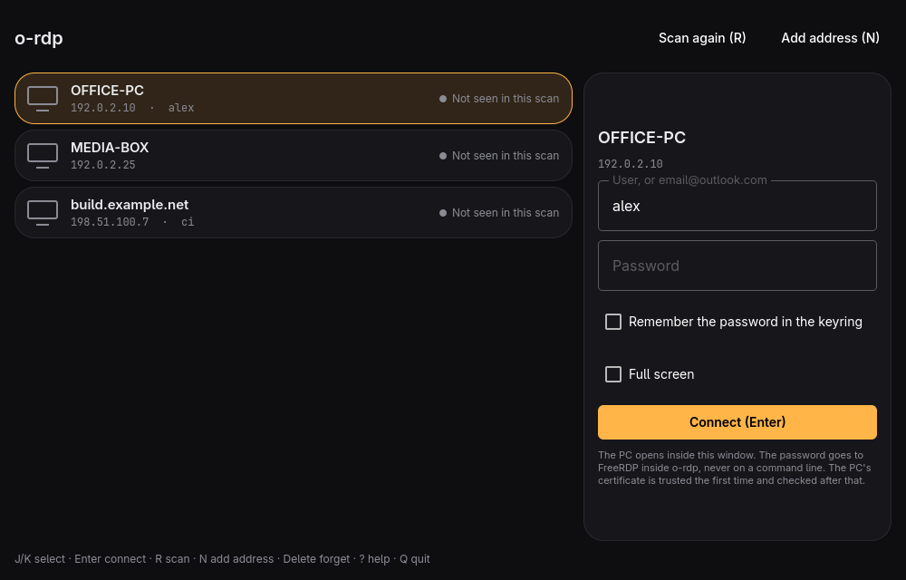

# o-rdp



o-rdp finds the PCs with Remote Desktop on your local network and connects to
them with FreeRDP. It is the window version of the `rdp-connect` script, and
shares its list of known PCs (`~/.local/state/rdp-connect/known`: address,
name and the last user), so either one picks up what the other learned.

## What it does

- **Scans** the subnet of the connection that carries the default route (so a
  VPN isn't scanned): a TCP connect to port 3389 on every address, 256 at a
  time, half a second each. Anything larger than a /20 is cut to the /24
  around this computer, as the script does. It scans when it opens; R scans
  again.
- **Names** each PC it finds: NetBIOS first (Windows answers with its own
  computer name), then reverse DNS, then Avahi.
- **Connects** with `xfreerdp3` and the script's options: a window that
  follows its size, the PC's certificate trusted the first time and checked
  after that, sound, clipboard, LAN settings and reconnecting. Full screen
  and all monitors are switches; `$RDP_OPTS` adds FreeRDP flags.
- **Passwords** are typed in the window. With "Remember the password in the
  keyring" ticked they are kept in the GNOME keyring (`secret-tool`, service
  `o-rdp`, per PC and user); unticking removes the stored one. The password
  reaches FreeRDP through `/args-from:stdin`, a pipe, never on a command line
  that other programs on the computer can read.
- **Says what went wrong** when a connection fails: the user name or
  password turned down, the account locked or expired, the PC unreachable, a
  changed certificate, with FreeRDP's last lines under it.

## Keys

| Key | Does |
| --- | --- |
| J / K, ↓ / ↑ | Select the next or previous PC |
| Enter, Space | Connect (or go to the field still missing) |
| R | Scan the network again |
| N | Add a PC by address or name |
| Delete | Forget the selected PC |
| Esc | Leave a field, or close what is open |
| Ctrl + / - / 0 | Text larger, smaller, default |
| ? | Every shortcut |
| Ctrl + I | About o-rdp |
| Q | Quit |

## Commands

```text
o-rdp scan [--json]              the PCs with port 3389 open, with names
o-rdp list [--json]              the PCs o-rdp and rdp-connect know
o-rdp connect HOST [--user U]    connect; the password from the keyring or asked here
o-rdp skill install              a short agent skill in ~/.claude/skills/o-rdp
```

## Install

```sh
bin/install
```

Needs `freerdp`; `libsecret` for the keyring and `avahi` for the last naming
step are optional.

## Development

```sh
bin/build     # build/o-rdp
bin/test      # the Qt Test suite, offscreen
```

The tests cover the subnet and address range, the default route, NetBIOS
queries and answers, the known-hosts file's format, FreeRDP's arguments and
error messages, the keyring calls, the scanner against a local port, and a
connection through a stand-in FreeRDP that records its arguments and stdin
(only `/args-from:stdin` on its command line, the password on stdin).

On this laptop (2026-11-17) a scan of a /22 took 1,997 ms; `rdp-connect
--list` took 2,590 ms on the same network. Both found no PC with port 3389
open at the time, so connecting to a real PC hasn't been tried yet.

## License

MIT
